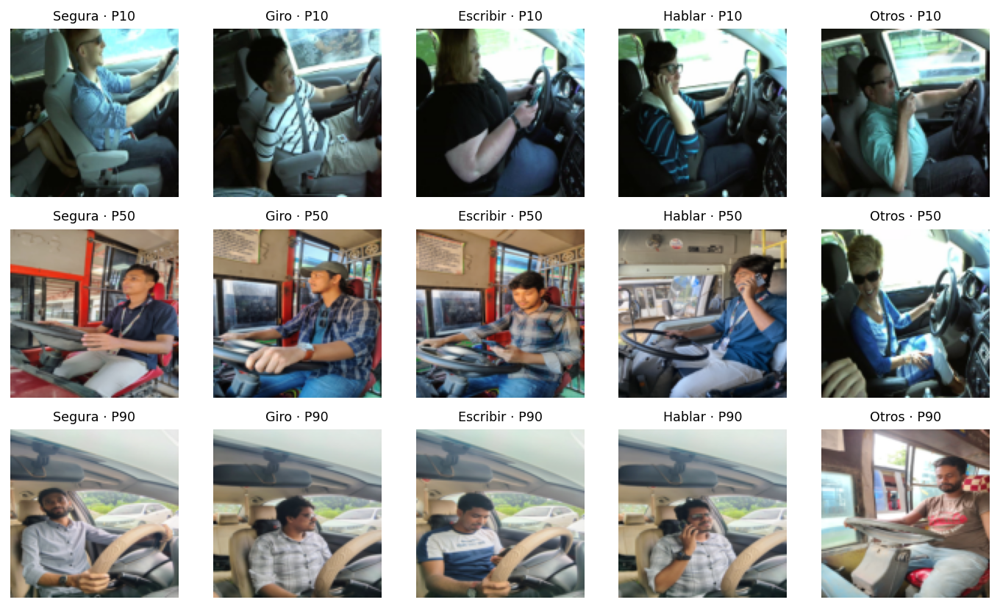
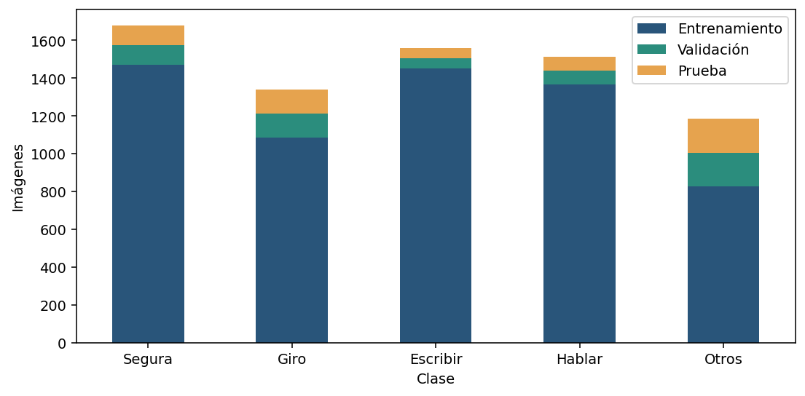
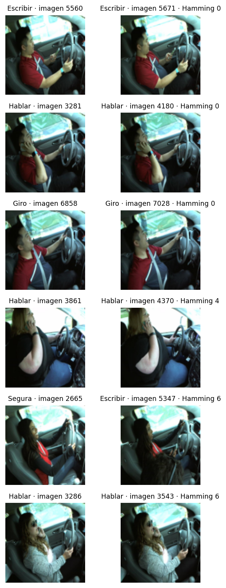
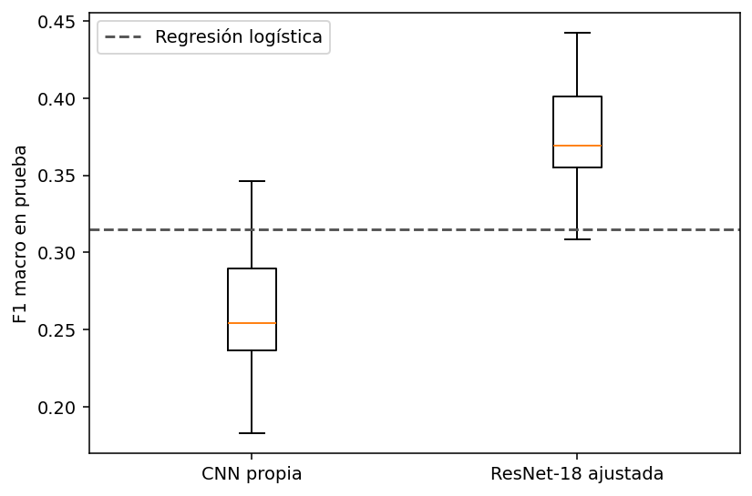
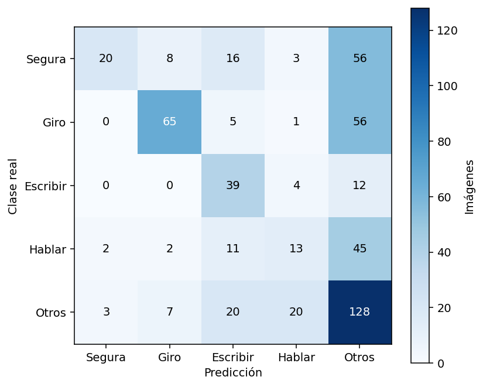
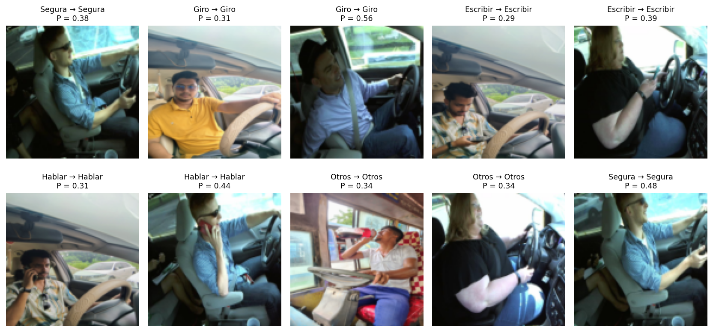
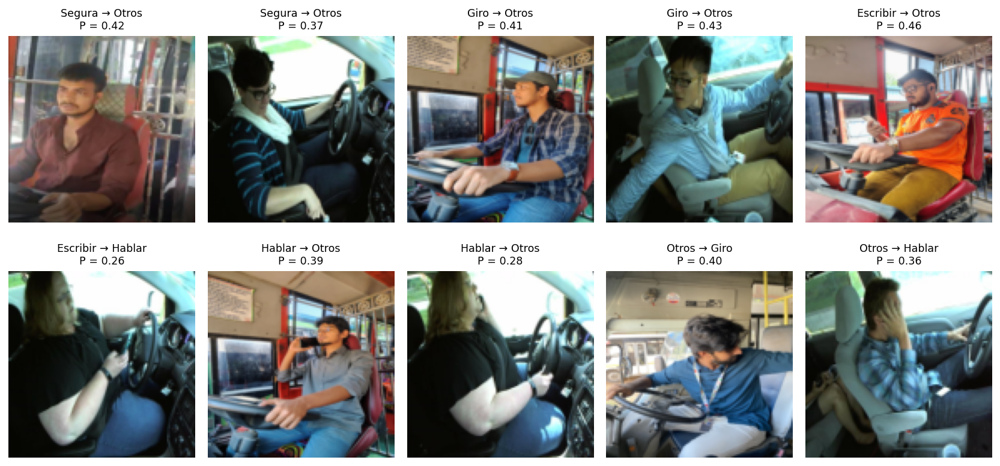
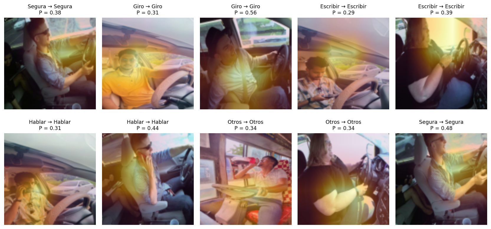
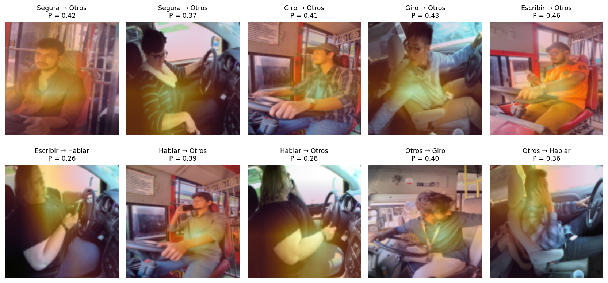
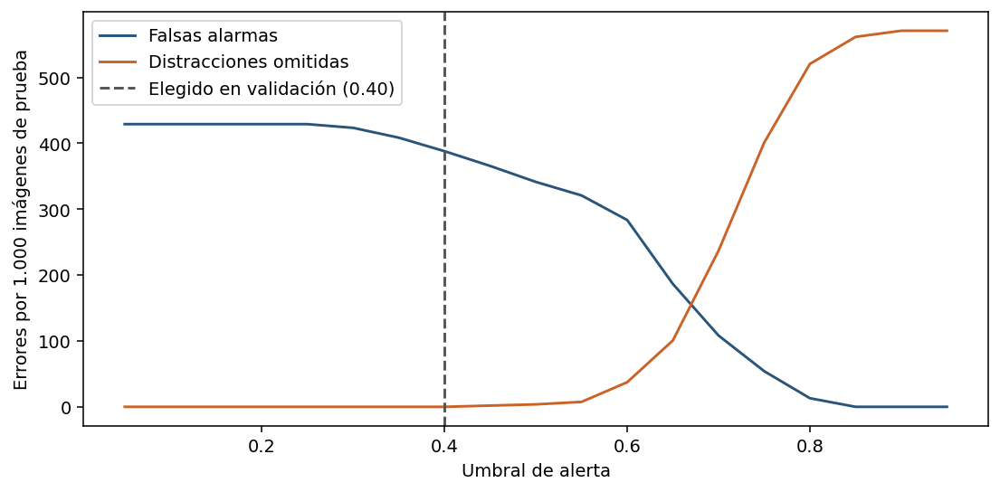

# Informe técnico del módulo 2 · Clasificación de conducción distractiva

Una cámara en cabina puede ayudar a detectar distracciones visuales y manuales mientras el vehículo está en movimiento. De los tres modelos evaluados, ResNet-18 con ajuste fino obtuvo el mejor F1 macro en validación y alcanzó 49,4 % de exactitud y 0,447 de F1 macro en prueba. Al umbral de 0,40 produjo 388,1 falsas alarmas por 1.000 imágenes con cero omisiones en esa muestra. Ese volumen de alarmas limita su uso a evaluación offline. La aplicación del repositorio permite probar fotografías con el modelo local.

## Caso de uso y presupuesto de operación

El destinatario inmediato es el conductor. Cuando el vehículo está en movimiento y la evidencia de distracción persiste, se emite un aviso sonoro breve para que retome la mirada al camino y libere el teléfono al hacerlo de forma segura. Un evento repetido puede quedar disponible para revisión de seguridad vial al finalizar el turno. La aplicación web clasifica imágenes individuales. El modo de video grabado toma 5 cuadros por segundo, requiere 3 positivos en una ventana de 5 cuadros y aplica un período de silencio posterior de 20 segundos. El sonido se puede habilitar al ejecutar la prueba. La validación en carretera requiere sincronizar cuadros y velocidad del vehículo y evaluar la regla con secuencias anotadas.

Se propone una cámara fija con encuadre de cara, manos y volante, alimentación vehicular y procesamiento local en un equipo de borde. El objetivo inicial es p95 inferior a 200 ms por cuadro para captura, decodificación e inferencia y aviso dentro de 1,2 s desde el inicio de una distracción persistente. Se medirían latencia, consumo térmico, oclusiones, reflejos y pérdida de cámara en el equipo final. Una cámara nocturna o infrarroja exige muestras propias. Para el piloto, enviar a supervisión conteos y marcas de tiempo por defecto y restringir el acceso y la retención de cualquier clip de revisión.

En un video de prueba de 24 s construido con imágenes repetidas, se evaluaron 120 cuadros. Una activación aislada quedó sin aviso. La secuencia persistente activó el primer aviso a los 1,4 s y el segundo a los 21,4 s. La medición del archivo incluye decodificación, inferencia y decisión temporal. La latencia desde la cámara y la validez de la política se evaluarán con datos de un vehículo real. [Prueba del flujo de video](../reports/tables/m2_video_smoke.json)

## Datos y construcción

Afridi y colaboradores describen fotos tomadas en Ashulia, Dhaka, en carros particulares y buses públicos, con un iPhone 11 y un Moto Edge 50 Fusion. Reportan 178 conductores de 20 a 50 años, 30 días de captura, vías urbanas y carreteras, varios ángulos y condiciones diurnas, de poca luz y nocturnas. Clasificaron manualmente las fotos en cinco conductas. La ficha de Mendeley fecha la captura en octubre de 2024. [Artículo, DOI 10.1016/j.dib.2025.111529](https://doi.org/10.1016/j.dib.2025.111529) · [Mendeley Data, DOI 10.17632/mzb4b6dff3.1](https://doi.org/10.17632/mzb4b6dff3.1)

| Clase | Imágenes por carpeta del ZIP | Proporción | Resolución declarada | Imágenes de 640 × 480 medidas |
| --- | ---: | ---: | --- | ---: |
| Conducción segura | 1.679 | 23,0 % | 400 × 600 px | 1.531 |
| Giro | 1.343 | 18,4 % | 400 × 600 px | 1.187 |
| Escribir en el teléfono | 1.561 | 21,4 % | 400 × 600 px | 1.505 |
| Hablar por teléfono | 1.513 | 20,8 % | 400 × 600 px | 1.434 |
| Otros comportamientos | 1.190 | 16,3 % | 400 × 600 px | 972 |
| **Total** | **7.286** | **100 %** | | **6.629** |

La sección 2.1 declara una resolución uniforme. La sección 3.2 documenta filtro mediano, ecualización de histograma y redimensionado a 224 × 224 para los modelos de los autores. La sección 3.3 describe aumento en línea con rotación de hasta 15°, espejo horizontal, brillo y recorte aleatorio. Las secciones 3.3 y 3.4 también describen versiones guardadas en las carpetas de cada clase, con rotaciones, espejos, zoom, brillo y recorte. El artículo enlaza su copia de Zenodo y Mendeley describe fotos sin procesar. Para interpretar el ZIP de noviembre de 2024 se requiere medir sus dimensiones y similitudes, pues los textos no identifican qué archivos derivan de cada original. [Artículo, secciones 2.1 y 3.2–3.4](https://pmc.ncbi.nlm.nih.gov/articles/PMC12019831/) · [Copia enlazada por el artículo](https://zenodo.org/records/14908802)

El ZIP de Mendeley tiene el SHA-256 publicado y los 7.286 nombres coinciden por clase con la tabla. Se pudieron decodificar 7.276. Los 10 archivos ilegibles corresponden a cuatro de giro y seis de otros. Las imágenes legibles tienen **34 resoluciones** medidas en el archivo original. La más común es **640 × 480 px**, con 6.629 imágenes (91,1 %). También aparecen 683 × 384 (183), 3072 × 4096 (182), 2460 × 3280 (135) y 4096 × 3072 (80). La frecuencia por clase y resolución queda en las tablas. [Resoluciones medidas](../reports/tables/m2_resoluciones.csv) · [Archivos ilegibles](../reports/tables/m2_archivos_ilegibles.csv)

La clase más grande tiene 1,41 veces las imágenes de la más pequeña. La luminancia media por foto se calculó en escala de 0 a 255 después de reducir la imagen. Las medianas van de 91,2 en escribir a 95,9 en otros. En otros, P10–P90 va de 82,5 a 119,0. En hablar va de 80,3 a 104,9. Las ventanas sobreexpuestas y las caras en sombra pueden coexistir en una misma foto. La inspección por grupos muestra cabinas de buses y carros, tomas laterales desde el puesto del pasajero y tomas más frontales y abiertas. La medición de luminancia es una aproximación al aspecto de cada foto. El ZIP no aporta un inventario de ángulos, tipos de vehículo o condiciones de luz por archivo. [Cuantiles de luminancia y contraste](../reports/tables/m2_iluminacion.csv)

La hipótesis inicial fue que **segura y giro** se confundirían al cambiar solo la mirada o la orientación de la cabeza. **Escribir y hablar** comparten el teléfono y pueden diferenciarse por dónde se ubica la mano, una señal que se pierde con oclusión. **Otros** puede confundirse con giro al voltear hacia atrás o con hablar al llevarse un objeto a la boca.

*Figura 1. Ejemplos de cada clase en grupos distintos, ordenados por luminancia dentro de la muestra.*

La serie dominante de 640 × 480 muestra una toma lateral de cabina repetida en diversas personas y conductas. Sus nombres numerados y encuadres son compatibles con el material de la competición State Farm, anterior a la recolección declarada. También hay capturas cuyos nombres aluden a 2019. Estas pistas ameritan verificar la procedencia y la correspondencia de clases con los autores. La inspección de nombres y encuadres carece de una referencia de origen por archivo. [Descripción de la competición de State Farm](https://www.kaggle.com/competitions/state-farm-distracted-driver-detection/data)

El modelo de cámara consta en EXIF en 436 imágenes, todas fuera del formato 640 × 480. Hay 404 identificadas como Motorola Edge 50 Fusion y 32 como iPhone 11. Las 6.629 imágenes del formato dominante carecen de ese campo. El EXIF corrobora los modelos de teléfono para la parte documentada del ZIP. [Inventario de EXIF](../reports/tables/m2_camaras.csv)

## Partición y comprobación de fuga

El objetivo de partición fue 70 % entrenamiento, 15 % validación y 15 % prueba. Entrenamiento ajusta pesos, validación selecciona configuraciones y calibra la política, y prueba estima el rendimiento del protocolo elegido. Se usó SHA-256 para archivos idénticos y una huella perceptual DCT de 63 bits en vistas de la misma imagen con espejo horizontal, rotaciones de ±8° y ±15° y recortes centrados al 80 % y 90 %, con y sin espejo. Una coincidencia requiere distancia mínima de Hamming de hasta 7 bits entre la vista íntegra de una imagen y alguna vista de la otra. Se agruparon los componentes conexos del grafo resultante y se repartieron grupos completos minimizando la desviación de conteos por clase. La auditoría verifica los SHA-256 y todas las aristas de similitud entre particiones.

Entre los archivos legibles hubo **cero coincidencias exactas por SHA-256**, **126.998 pares perceptuales** y **544 grupos**. De los pares, 2.777 tuvieron distancia cero en alguna vista. En 51 grupos aparecen varias etiquetas. Esto puede deberse tanto a poses o encuadres parecidos entre conductas distintas como a rótulos ambiguos. La revisión visual de los pares muestra secuencias casi iguales y similitudes debidas a una cabina compartida. El grupo más grande reúne 6.188 imágenes y queda entero en entrenamiento. El reparto real sacrifica cercanía a la proporción objetivo para mantener los grupos indivisibles.

| Clase | Entrenamiento | Validación | Prueba | Total legible |
| --- | ---: | ---: | ---: | ---: |
| Segura | 1.472 | 104 | 103 | 1.679 |
| Giro | 1.085 | 127 | 127 | 1.339 |
| Escribir | 1.450 | 56 | 55 | 1.561 |
| Hablar | 1.366 | 74 | 73 | 1.513 |
| Otros | 828 | 178 | 178 | 1.184 |
| **Total** | **6.201** | **539** | **536** | **7.276** |
| Grupos visuales | 14 | 270 | 260 | 544 |

La revisión posterior al reparto dio **0 coincidencias detectadas entre particiones** con la regla anterior. La cobertura depende de las vistas y transformaciones probadas. Recortes desplazados, oclusiones o cambios fuertes de perspectiva pueden escapar a la huella y un mismo conductor puede aparecer sin coincidencia visual. El ZIP carece de identificadores verificables de conductor, sesión y foto original. El reparto del 85,2 % / 7,4 % / 7,4 % constituye una prueba de cambio de encuadre dentro de este archivo. El tamaño de los grupos y la composición de cada partición afectan la generalización y el costo de alertas. [Auditoría](../reports/tables/m2_auditoria.json) · [Distribución en CSV](../reports/tables/m2_distribucion.csv)

Con 120 fotos del ZIP y variantes de origen conocido, la regla recuperó 120 espejos, 120 reducciones de brillo al 70 %, 115 rotaciones de 11° y 118 recortes centrados que conservaban el 85 % de cada eje. Recuperó 0 de 120 recortes asimétricos que conservaban el 80 % desde la esquina superior izquierda. Ese ensayo mide el alcance de la comprobación bajo transformaciones controladas. [Sensibilidad de las huellas](../reports/tables/m2_sensibilidad_huellas.csv)

La auditoría complementaria compara 48 recortes descentrados por imagen, obtenidos de seis escalas entre 80 % y 90 % y ocho anclajes en las esquinas o cerca de ellas. Un par requiere distancia de Hamming de hasta 7 y correlación de luminancia de al menos 0,975 después de alinear el recorte. Entre particiones se detectaron cero pares bajo ese criterio. En los controles positivos se recuperaron 120 de 120 recortes de esquina al 80 %, 119 de 120 al 83 % y 120 de 120 desplazados al 83 %. El resultado se limita al rango de geometrías probadas y mantiene el reparto por grupos. [Pares entre particiones](../reports/tables/m2_recortes_entre_particiones.csv) · [Controles de recorte](../reports/tables/m2_sensibilidad_recortes.csv)

*Figura 2. Imágenes legibles por clase y partición.*

*Figura 3. Seis pares de la auditoría visual. La distancia indica similitud de huella y admite coincidencias entre etiquetas.*

## Modelos y selección

La referencia aprende una regresión logística multinomial a partir de 512 características de ResNet-18 con pesos ImageNet congelados. El escalado de características se ajusta en entrenamiento. Se comparan valores de $C$ de 0,01, 0,1 y 1 en validación. La CNN propia encadena bloques convolucionales 3 × 3, el primero con paso 2, con normalización por lotes, ReLU y max pooling, agrega pooling promedio adaptativo de 2 × 2 y entrena sus pesos desde cero. La ResNet-18 de transferencia sustituye la cabeza y ajusta los bloques finales con una tasa de aprendizaje del 20 % de la usada en la cabeza. Las estadísticas de normalización de la red preentrenada quedan fijas. [He et al., Deep Residual Learning for Image Recognition](https://www.cv-foundation.org/openaccess/content_cvpr_2016/html/He_Deep_Residual_Learning_CVPR_2016_paper.html)

La búsqueda combina una configuración inicial y muestras aleatorias reproducibles para recorrer ancho y profundidad de la CNN, bloques descongelados de ResNet-18, intensidad de aumento, dropout, decaimiento de pesos, AdamW o SGD con momento y sus tasas de aprendizaje. El muestreo permite explorar varios valores de cada parámetro dentro del presupuesto de CPU, sin evaluar todas las combinaciones. Asigna cuatro ensayos de dos épocas a cada red, con una semilla común, entradas de 112 × 112 px y lotes de 64 imágenes. Se entrena y puntúa por imagen. Cada ensayo conserva la época de mayor F1 macro de validación. Se elige familia por esa misma métrica y se evalúan las tres familias en prueba con la elección fijada. [Configuración](../configs/m2_conduccion.yaml) · [Registro de búsqueda](../reports/tables/m2_busqueda.json)

### Resultados en las 536 imágenes de prueba

| Modelo | F1 macro validación | Exactitud prueba | F1 macro prueba |
| --- | ---: | ---: | ---: |
| Regresión logística con ResNet-18 congelada | 0,286 | 34,1 % | 0,315 |
| CNN desde cero | 0,293 | 24,3 % | 0,217 |
| **ResNet-18 con ajuste fino** | **0,314** | **49,4 %** | **0,447** |

La referencia seleccionó (C=0,1). La mejor CNN propia usó tres bloques con 16 canales iniciales, aumento moderado, dropout 0,4, AdamW, tasa 0,001 y decaimiento 0,001. La ResNet-18 elegida ajustó el último bloque y la cabeza en dos épocas, con SGD con momento 0,9, tasa 0,003 en la cabeza y 0,0006 en el extractor, dropout 0,4 y decaimiento 0,00001. Su ensayo usó las imágenes de entrenamiento con el preprocesamiento determinista. [Comparación](../reports/tables/m2_modelos.csv) · [Configuraciones y curvas por época](../reports/tables/m2_busqueda.json)

| Clase | Soporte | Logística P / S | CNN propia P / S | ResNet-18 ajustada P / S |
| --- | ---: | ---: | ---: | ---: |
| Segura | 103 | 22,4 / 10,7 % | 22,6 / 23,3 % | 80,0 / 19,4 % |
| Giro | 127 | 55,0 / 48,0 % | 44,4 / 44,1 % | 79,3 / 51,2 % |
| Escribir | 55 | 23,0 / 36,4 % | 9,1 / 3,6 % | 42,9 / 70,9 % |
| Hablar | 73 | 17,5 / 32,9 % | 10,5 / 27,4 % | 31,7 / 17,8 % |
| Otros | 178 | 44,1 / 37,6 % | 30,4 / 15,7 % | 43,1 / 71,9 % |

P indica precisión y S sensibilidad. La ResNet-18 predijo «otros» en 297 imágenes, de las cuales 128 pertenecían a la clase. Los mayores flujos de error fueron segura → otros y giro → otros (56 cada uno) y hablar → otros (45). Entre las 73 fotos de hablar, 11 pasaron a escribir. La confusión dominante con «otros» supera la confusión segura → giro (8 casos) que se planteó inicialmente. [Métricas por clase](../reports/tables/m2_metricas_clase.csv) · [Predicciones de prueba](../reports/tables/m2_predicciones.csv)

En el grupo de 640 × 480 px, la exactitud fue 68,8 % y el F1 macro 0,648 (276 fotos de prueba). En los demás formatos fueron 28,8 % y 0,167 (260 fotos). El formato sirve aquí como aproximación a diferencias de encuadre y procedencia. La composición de clases también cambia entre los dos grupos. La medición local de inferencia con seis hilos de CPU dio 9,1 ms de mediana y 9,8 ms de p95 sobre el tensor ya redimensionado. La latencia vehicular se mediría desde la captura hasta la alerta. [Latencia local](../reports/tables/m2_latencia.csv)

### Estabilidad y costo de cómputo

Se reentrenó cada configuración final con 30 semillas consecutivas, de 2026 a 2055, con las mismas particiones y dos épocas por corrida. En cada corrida se conservó la época de mayor F1 macro en validación y se evaluó en prueba. Para ResNet-18 se precalcularon las activaciones hasta la tercera etapa residual, `layer3`, porque la configuración final usa entradas sin aumento y congela esas capas. La prueba numérica verifica que ejecutar la etapa final y la cabeza sobre esas activaciones reproduce los logits del modelo completo.

| Red y métrica de prueba | Media | Desv. estándar | Mejor | Peor |
| --- | ---: | ---: | ---: | ---: |
| CNN propia, exactitud | 0,297 | 0,039 | 0,364 | 0,228 |
| CNN propia, F1 macro | 0,264 | 0,043 | 0,346 | 0,183 |
| ResNet-18 ajustada, exactitud | 0,429 | 0,039 | 0,498 | 0,354 |
| ResNet-18 ajustada, F1 macro | 0,376 | 0,035 | 0,443 | 0,309 |

El F1 macro medio de ResNet-18 supera en 0,061 el 0,315 de la regresión logística de referencia. La CNN propia queda 0,050 por debajo de la referencia en promedio. Se comparan las medias de 30 entrenamientos con el valor de la logística, cuyo ajuste usa características congeladas y un optimizador determinista sobre la partición fija. La ResNet-18 que se publicó para la demo es la de la comparación original en CPU, elegida por validación. Las 60 corridas se ejecutaron en una RTX 4060 con PyTorch 2.6 y CUDA 12.4. La retropropagación del pooling adaptativo de la CNN en CUDA puede producir pequeñas variaciones numéricas en una repetición con la misma semilla. [Métricas por semilla y clase](../reports/tables/m2_semillas.csv) · [Estadísticos completos](../reports/tables/m2_resumen_semillas.csv)

La CNN tiene **24.981** parámetros entrenables, la regresión logística **2.565** y ResNet-18 ajusta **8.396.293** de **11.179.077**. Las 30 corridas de la CNN tomaron 221,7 s. Las de ResNet-18 tomaron 140,5 s, con 3,0 s para precalcular activaciones. Los tiempos de esta etapa incluyen la evaluación de cada semilla. [Parámetros](../reports/tables/m2_parametros.csv) · [Tiempo de estabilidad](../reports/tables/m2_tiempos_estabilidad.csv)

La repetición de la búsqueda en la RTX 4060 tomó **90,0 s** en total. La extracción de características y los tres ajustes de la regresión logística tomaron 8,8 s, los cuatro ensayos de la CNN tomaron 37,0 s y los cuatro de ResNet-18 tomaron 44,2 s. La regresión ajusta el clasificador con scikit-learn en CPU tras extraer características en GPU. Esta repetición mide el presupuesto del procedimiento y conserva la selección original empleada en la demo. [Tiempo por familia](../reports/tables/m2_tiempos_busqueda.csv)

*El diagrama compara las 30 corridas de cada red con el F1 macro de la regresión logística.*

*Figura 4. Filas con la clase real y columnas con la predicción del modelo elegido.*

### Ejemplos e interpretabilidad

Las figuras muestran 10 aciertos y 10 errores de prueba. La selección prioriza grupos visuales distintos y ambos formatos dentro de cada clase cuando hay ejemplos disponibles. Cada panel muestra la clase real, la predicción y la probabilidad calibrada de la clase predicha. [Índice de ejemplos](../reports/tables/m2_ejemplos.csv)

*Figura 5. Diez aciertos de prueba.*

*Figura 6. Diez errores de prueba.*

*Figura 7. Grad-CAM para los aciertos.*

*Figura 8. Grad-CAM para los errores.*

En los aciertos de giro y conducción segura aparecen activaciones sobre torso, brazos y volante. En los ejemplos 6 y 7 de hablar, el mapa abarca parte de la cara y de la mano cerca del oído. En el ejemplo 4 de escribir, la activación más intensa cae hacia el parabrisas y el borde del techo, aunque el teléfono está abajo, junto a las manos. En el 8 de otros se ve una botella en la boca y la respuesta más intensa se concentra en el volante y el torso. El modelo usa regiones del conductor, pero la evidencia visual también alcanza zonas de cabina y fondo. Los mapas parten de una cuadrícula de 4 × 4 antes de interpolar, lo que limita la separación entre objetos pequeños y regiones vecinas.

La tabla describe los errores de izquierda a derecha y de arriba abajo. Las explicaciones son hipótesis basadas en lo visible y en el mapa de la clase predicha.

| Panel | Clase real → predicha | Evidencia visual |
| --- | --- | --- |
| 1 | Segura → Otros | En la captura frontal, la región dominante abarca pecho y cara. El encuadre estrecho deja poca evidencia del volante. |
| 2 | Segura → Otros | La mirada hacia abajo y una mano baja se parecen a varias distracciones. El mapa abarca torso y muñeca. |
| 3 | Giro → Otros | En el bus, la postura lateral y el brazo en el volante aparecen junto con elementos de cabina. La toma da poca evidencia del movimiento del vehículo. |
| 4 | Giro → Otros | El conductor rota el torso. El mapa cae sobre la camisa y el apoyabrazos, zonas compartidas por giro y acciones hacia el asiento vecino. |
| 5 | Escribir → Otros | Se observa un teléfono bajo al lado del volante. La activación se concentra en antebrazo y torso. |
| 6 | Escribir → Hablar | El teléfono está cerca del volante. El mapa cubre cara y ventana, con señal débil sobre la posición del dispositivo. |
| 7 | Hablar → Otros | Hay un teléfono cerca de la cara. La activación más intensa aparece sobre el brazo que sujeta el volante y sobre el torso. |
| 8 | Hablar → Otros | El pelo y el perfil dificultan ver el área del oído. La activación abarca el otro brazo y la mano en el volante. |
| 9 | Otros → Giro | Cabeza y hombro se orientan hacia un lado. Esa postura también aparece en maniobras de giro y es la región que resalta. |
| 10 | Otros → Hablar | La mano apoyada junto a la sien reproduce la silueta de una llamada. La región resaltada incluye mano, cabello y apoyacabezas. |

## Política de alertas

Se asignan **segura y giro** a sin alerta. El giro del vehículo es una maniobra esperada y puede requerir mirar espejos o puntos ciegos. Se asignan **escribir, hablar y otros** a con alerta por el posible desvío de la mirada, de las manos o de la atención. La categoría «otros» es heterogénea y su uso para alertar debe validarse por subtipo.

El riesgo $r$ es la suma de las tres probabilidades con alerta y se dispara cuando $r\ge t$. La suma permite detectar riesgo repartido entre varias clases. Se usa $p=\operatorname{softmax}(z/T)$ con $T=5,09$, obtenido al minimizar la entropía cruzada en validación. Se tomó **5:1** como costo relativo inicial de una distracción omitida frente a una falsa alarma. Para probabilidades calibradas, comparar $C_{FP}(1-r)$ con $C_{FN}r$ da el umbral teórico $1/6$. El umbral experimental se elige minimizando $FP+5FN$ en la cuadrícula de validación, incluido $1/6$. Los errores por 1.000 se calculan como $1000\,FP/n$ y $1000\,FN/n$, con $n$ igual al número total de imágenes de la partición.

El umbral seleccionado fue **0,40**, con costo 398,9 por 1.000 imágenes de validación. En prueba provocó **208 falsas alarmas y cero omisiones** de 536 imágenes, equivalentes a **388,1 falsas alarmas y 0 omisiones por 1.000 imágenes**. Alertó en 514 de 536 fotos (95,9 %), incluidas 208 de las 230 imágenes sin distracción según la agrupación (90,4 %). Este volumen hace que la política sirva como referencia offline. Antes de emitir alertas en cabina, la flota necesita una validación que mida la fatiga por alertas y los errores por evento.

| Umbral | Falsas alarmas por 1.000 | Omisiones por 1.000 | Costo por 1.000 |
| ---: | ---: | ---: | ---: |
| 0,05 | 429,1 | 0,0 | 429,1 |
| 0,167 (~1/6) | 429,1 | 0,0 | 429,1 |
| 0,30 | 423,5 | 0,0 | 423,5 |
| **0,40** | **388,1** | **0,0** | **388,1** |
| 0,50 | 341,4 | 3,7 | 360,1 |
| 0,60 | 283,6 | 37,3 | 470,1 |
| 0,70 | 108,2 | 236,9 | 1.292,9 |
| 0,90 | 0,0 | 570,9 | 2.854,5 |

El umbral 0,50 tuvo menor costo observado en prueba. La elección de 0,40 se fijó con validación antes de abrir la prueba. Estos valores dependen de la prevalencia y del encuadre de los datos. [Barrido completo de validación](../reports/tables/m2_alertas_val.csv) · [Barrido completo de prueba](../reports/tables/m2_alertas_test.csv)

También se evaluó una política que limita a 20 % la proporción de falsas alarmas **entre imágenes sin distracción** en validación. Dentro de la misma cuadrícula, el menor costo admisible se obtuvo a 0,75. En prueba, ese umbral produjo 29 falsas alarmas sobre 230 imágenes sin distracción (12,6 %) y omitió 215 de 306 distracciones (70,3 %). Esto equivale a 54,1 falsas alarmas y 401,1 omisiones por 1.000 imágenes. A 0,40, las 73 imágenes de «hablar» activaron la alerta binaria y 13 recibieron la etiqueta multiclase correcta. El umbral modifica la decisión binaria y no cambia la clasificación multiclase. La comparación muestra que la baja capacidad de discriminación persiste con límites más estrictos de falsas alarmas. [Políticas comparadas](../reports/tables/m2_politicas_validacion.csv)

*Figura 9. Errores por 1.000 imágenes de prueba. Las falsas alarmas quedan por encima o en el umbral y las omisiones por debajo.*

## Generalización a una flota colombiana

La posición de la cámara y el lado del volante pueden cambiar las ubicaciones del teléfono y de las manos. El montaje fijo puede reducir la variación del ángulo, mientras que el contraluz y la noche podrían ocultar el teléfono o alterar los colores. Diferencias de cabina, uniformes, rutas y comportamiento pueden cambiar la prevalencia y la calibración. Se espera mayor degradación para las conductas en que el teléfono queda pequeño, tapado o fuera del encuadre y para «otros» por su heterogeneidad.

Se propone un piloto en sombra en buses y vehículos livianos, con rutas, turnos y configuraciones de cámara variadas. Dos personas anotarían eventos y un tercero resolvería desacuerdos. Se reservarían conductores, vehículos y trayectos completos para una prueba colombiana independiente. La calibración y el umbral se ajustarían en la validación local. En la prueba se medirían sensibilidad por conducta, falsas alarmas por hora, distracciones omitidas por 100 eventos, latencia hasta aviso e intervalos de confianza con remuestreo por viaje. Conviene fijar los límites de aceptación con Seguridad Vial antes del piloto y pasar a alertas audibles tras revisarlos por tipo de vehículo y franja de iluminación.

## Medidas preventivas

Escribir y hablar suman 3.074 de las 7.286 imágenes publicadas. Esa frecuencia describe el archivo. Su equivalente en carretera se estimaría en el piloto. Para reducir ambos comportamientos, configurar navegación antes de partir, activar el modo conducción del teléfono y pactar que despacho envíe solicitudes que puedan esperar hasta una parada. Las llamadas que requieran interacción se gestionan durante pausas seguras. La sensibilidad de 17,8 % para hablar refuerza la prioridad de esas medidas. Para riesgos de fatiga, programar descansos y un canal para reportar somnolencia. Para reducir falsas alarmas en conducción segura y giro, incorporar maniobras normales de la flota y verificar que el montaje mantenga visibles cara, volante y manos. Separar acciones como beber, buscar objetos y voltear hacia atrás al etiquetar nuevos datos ayudaría a investigar el uso excesivo de la clase «otros».

## Fundamentación matemática

### Convolución, pooling y normalización

En una capa convolucional, con canal de salida $k$ y paso $s$, $z_{ijk}=b_k+\sum_{c,u,v}K_{kuvc}x_{si+u,sj+v,c}$. Las librerías implementan esta correlación cruzada con pesos compartidos y padding en los bordes. ReLU aplica $\max(0,z)$. El max pooling calcula $m_{ijk}=\max_{(u,v)\in W}a_{si+u,sj+v,k}$. El pooling promedio adapta cada región por media y produce una representación de tamaño fijo.

La normalización por lotes transforma $a$ en $\gamma(a-\mu_B)/\sqrt{\sigma_B^2+\epsilon}+\beta$. Durante el entrenamiento de la CNN propia, $\mu_B$ y $\sigma_B^2$ se estiman por canal en el lote y posiciones espaciales. En evaluación se usan los promedios acumulados. La red transferida usa las estadísticas de ImageNet en ambas fases.

### Softmax y entropía cruzada

Para logits $z_k$, $p_k=\exp(z_k)/\sum_j\exp(z_j)$. Para una etiqueta one-hot $y_i$, la verosimilitud categórica es $P(y_i\mid x_i)=\prod_k p_{ik}^{y_{ik}}$. El producto sobre $n$ observaciones es la verosimilitud multinomial de los resultados individuales. Tomar el logaritmo, negar y promediar da $\mathcal L=-n^{-1}\sum_i\sum_k y_{ik}\log p_{ik}$, equivalente a $n^{-1}\sum_i[\log\sum_k e^{z_{ik}}-z_{i,y_i}]$ con $y_i$ como índice en el segundo término. La regresión usa $z=W\phi(x)+b$ y penalización $\ell_2$.

### Ajuste fino y aumento

Escribimos $z=h_w(f_{\theta_F,\theta_U}(x))$, con $\theta_F$ congelado, $\theta_U$ ajustable y $w$ la cabeza. Se minimiza $\mathbb E_{(x,y),\,a}[\mathcal L(h_w(f_{\theta_F,\theta_U}(a(x))),y)]$ y se seleccionan regularización y optimizador en validación. El ajuste del extractor usa $\eta_U=0,2\,\eta_w$. Dropout aplica $a'=a\,m/(1-q)$ con $m\sim\mathrm{Bernoulli}(1-q)$ durante entrenamiento.

El aumento en línea aplica una transformación afín de coordenadas $u'=sR_\theta(u-c)+c+t$ con interpolación bilineal, escalas de 0,92 a 1,08 y traslación de hasta 4 % por eje. La variante leve usa $\theta\in[-5^\circ,5^\circ]$ y factores de brillo y contraste en $[0,88,1,12]$, la moderada usa $[-12^\circ,12^\circ]$ y $[0,75,1,25]$. El brillo multiplica por un factor y el contraste escala el desvío de una intensidad de referencia, con saturación en el rango de píxel. La búsqueda también considera desactivar el aumento. Los parámetros aleatorios se comparten dentro de cada lote. Validación y prueba usan redimensionado y normalización deterministas.

### Métricas y Grad-CAM

La exactitud es $\sum_k TP_k/n$. Para la clase $k$, precisión $=TP_k/(TP_k+FP_k)$ y sensibilidad $=TP_k/(TP_k+FN_k)$. $F1_k=2TP_k/(2TP_k+FP_k+FN_k)$ y F1 macro promedia $F1_k$ con igual peso para las cinco clases. En denominadores nulos se asigna cero. La matriz de confusión usa filas reales y columnas predichas.

Grad-CAM toma el gradiente del logit de la clase predicha $z_c$ con respecto a sus mapas espaciales $A^k$. Pondera cada mapa con $\alpha_k^c=\frac1{HW}\sum_{i,j}\frac{\partial z_c}{\partial A_{ij}^k}$ y genera $L^c=\operatorname{ReLU}(\sum_k\alpha_k^c A^k)$. Se interpola al tamaño de entrada y se superpone a la foto. El método permite localizar evidencia espacial favorable a la predicción y evaluar posibles dependencias del fondo. La baja resolución espacial puede fusionar teléfono, mano y cara y la superposición por sí sola no establece causalidad. [Selvaraju et al., Grad-CAM, ICCV 2017](https://openaccess.thecvf.com/content_iccv_2017/html/Selvaraju_Grad-CAM_Visual_Explanations_ICCV_2017_paper.html)
